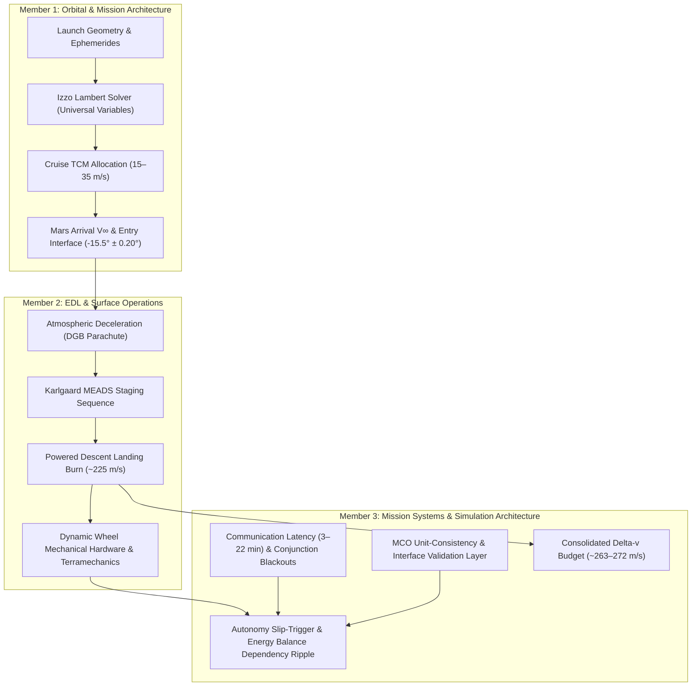

# COSMOS AI — Mars Mission Planner
**Theoretical Mars Mission Simulation Framework & Interactive 3D Working Prototype**

[](https://www.python.org/downloads/)
[](https://streamlit.io)
[](https://threejs.org)
[]()
[]()

A comprehensive, flight-validated mission planning simulation platform and interactive mission control dashboard for interplanetary Mars exploration. Developed for **COSMOS AI**, this framework models the **interconnected physical, orbital, aerodynamic, propulsive, terramechanic, telecommunication, and electrical constraints** of a Mars surface mission as a single, closed-loop dependency pipeline.

---

## 1. Executive Summary & Case Study

Interplanetary space mission design cannot treat mission phases as isolated calculations. Choosing a trajectory to minimize departure $\Delta v$ can produce an extended transit duration, higher Mars arrival velocity, more demanding entry heating, elevated parachute opening loads, heavier descent propellant requirements, and reduced surface payload margins.

To ground all mathematical and physical formulations concretely, the system is modeled against a flight-representative baseline:

| Mission Parameter | Case Study Baseline: `COSMOS-MARS-01` |
| :--- | :--- |
| **Mission Type** | Autonomous Robotic Science Rover |
| **Payload Mass** | $500\text{ kg}$ (MSL Curiosity / Mars 2020 Perseverance Class) |
| **Primary Mission Duration** | $500\text{ Sols}$ (~$514\text{ Earth days}$) |
| **Core Science Goals** | In-situ Martian geology, mineralogy, and habitability analysis |
| **Primary Power Source** | Multi-Mission Radioisotope Thermoelectric Generator (MMRTG) |
| **Primary Traction Mode** | Autonomous Terrain-Responsive Dynamic Cleat Wheels |
| **Launch Opportunity** | 2026 Earth–Mars Synodic Launch Window (May–June 2026) |

---

## 2. Full Mission Dependency Chain

Every subsystem output becomes the downstream input for the next stage. A single decision in the orbital phase cascades through the entire architecture:

```
Launch Date (Constrained by 779.9-day Synodic Period)
   │
   ▼
Planetary State (Ephemerides: Earth & Mars 3D State Vectors)
   │
   ▼
Izzo Lambert Solver (Type I Transfer Trajectory & Porkchop Grid)
   │
   ▼
Trajectory Parameters (Departure C3 Energy, Cruise TCMs, Time of Flight)
   │
   ▼
Mars Arrival Conditions (Arrival V∞, Entry Radius r = 3,522.2 km, EFPA Corridor -15.5° ± 0.20°)
   │
   ▼
EDL Aerodynamics (Cruz et al. DGB Parachute Deploy at Mach 1.75, Dynamic Pressure, MEADS Staging)
   │
   ▼
Powered Descent Landing Burn (~225–233 m/s: Kinematic Decel + Martian Gravity Loss + Divert)
   │
   ▼
Touchdown Mass (Tsiolkovsky Propellant Depletion → Landed 500 kg Rover)
   │
   ▼
Autonomous Dynamic Mobility (Slip-detection threshold s > 30% → Deploy Active Cleats)
   │
   ▼
Surface Resources & Power (MMRTG vs. Solar with Atmospheric τ Dust Factor → 500-Sol Longevity)
   │
   ▼
Telecommunications (Earth-Mars Light-Time: 3–22 min, Solar Conjunction Blackout Windows)
   │
   ▼
Constraint Engine (Mars Climate Orbiter 100% SI Unit Contract & Interface Verification)
   │
   ▼
Mission Feasibility (FEASIBLE / CONDITIONALLY FEASIBLE / HIGH RISK / INFEASIBLE)
```

---

## 3. Subsystem Breakdown & Team Ownership

The project is structured into three integrated engineering tracks:



---

## 4. Research Grounding & Flight Telemetry

Every quantitative parameter in the simulation is anchored in peer-reviewed literature and flight-reconstructed NASA/ESA telemetry:

| Subsystem | Research Paper / Reference | Flight Baseline & Key Quantified Values | Role in Simulation Engine |
| :--- | :--- | :--- | :--- |
| **Orbital** | **NASA Mars Mission Design Handbook** | Synodic period $T_{syn} \approx 779.9\text{ days}$; Type I transfer geometry. | Sets launch recurrence intervals and heliocentric boundary conditions. |
| **Orbital** | **Izzo, D. (2015)**, *Lambert's Problem Revisited* | Lancaster–Blanchard transformation variables, universal variable bisection formulation. | Computes transfer arcs in $<2\text{ iterations}$ without numerical singularities for porkchop generation. |
| **Orbital** | **MSL Navigation Team Study** | Cruise $\Delta v = 15\text{--}35\text{ m/s}$ (5–6 TCMs); Entry radius $r = 3,522.2\text{ km}$; Entry corridor $\gamma_{EI} = -15.5^\circ \pm 0.20^\circ$. | Direct handoff from interplanetary cruise to EDL atmospheric interface. |
| **EDL** | **Cruz et al.**, *MSL Parachute Reconstruction* | $21.35\text{ m}$ Disk-Gap-Band (DGB) parachute; Mach 1.75 deploy; $153.8\text{ kN}$ peak load vs. $289\text{ kN}$ rating limit; $C_d \approx 0.624$. | Validates parachute structural safety margin ($2.02\times$ factor). |
| **EDL** | **Karlgaard et al.**, *MEADS Trajectory Reconstruction* | Staging: Chute deploy at Mach 1.7 $\to$ Heatshield jettison at Mach 0.7 $\to$ Backshell separation at $1.6\text{ km} / 79\text{ m/s}$ $\to$ Powered divert $\to$ Sky crane at $18.6\text{ m}$. | Kinematic milestone validation for the terminal atmospheric descent profile. |
| **EDL** | **Korzun & Edquist**, *Powered Descent Development Status* | Supersonic retropropulsion (SRP) sits at TRL 3–4 for payloads $>1.5\text{ t}$; unvalidated aero below Mach 1.4; deep throttling risks. | Gating check: Restricts `COSMOS-MARS-01` to flight-proven Sky Crane (TRL 9) and flags heavy payloads as High Risk. |
| **EDL** | **Hwang et al.**, *MEDLI2* | In-flight reconstructed sensor tolerances: Axial force $\pm 2\%$, density $\pm 5\%$, aftbody heat flux $\pm 3\text{ W/cm}^2$. | Defines aerodynamic dispersion bounds and entry margin checks. |
| **Systems** | **Ely et al. (NASA NTRS 2022)** | One-way light time $\tau = 3\text{ to } 22\text{ min}$ (round-trip up to $44\text{ min}$); Conjunction blackouts: $4^\circ$ S-band, $2.3^\circ$ X-band, $1^\circ$ Ka-band; 10–14 day command moratoria. | Enforces mandatory autonomy for EDL and mobility (no ground-in-the-loop control possible). |
| **Systems** | **JPL DESCANSO Telecom Reference** | UHF store-and-forward relay via MRO/Odyssey ($>90\%$ telemetry); X-band DTE window $\approx 0.5\text{ sol}$; downlink rate $0.5\text{--}4\text{ Mbps}$. | Models realistic science data return volume (~$350\text{ MB/sol}$). |
| **Systems** | **NASA Mishap Investigation Board (1999)**, *Mars Climate Orbiter* | Loss of spacecraft due to metric/imperial unit discrepancy ($\text{lbf}\cdot\text{s}$ vs. $\text{N}\cdot\text{s}$) across software handoffs. | Mandates strict SI dimensional assertions at all subsystem boundaries. |
| **Systems** | **Cano et al.**, *ExoMars Mission Analysis and Design* | Phase-component delta-v aggregation methodology + 5% ESA policy margin. | Assembles and verifies the closed propulsive delta-v budget. |

---

## 5. Consolidated Delta-v Budget Resolution

The mission budget resolves all open questions by separating **propulsive velocity changes (engine burns)** from **energy/power storage budgets (watts, batteries, amp-hours)**:

| Mission Phase | Delta-v | Status | Engineering Basis & Resolution Notes |
| :--- | :---: | :---: | :--- |
| **Earth Departure ($C_3 \approx 11.1\text{--}18.0\text{ km}^2/\text{s}^2$)** | Derived | Sourced | Provided by launch vehicle upper stage (not craft propellant). |
| **Cruise TCMs (5–6 burns)** | $15\text{--}35\text{ m/s}$ | Flight-Allocated | Trajectory fine-tuning corrections (MSL Navigation Study baseline). |
| **Mars Orbit Insertion (MOI)** | **N/A** | **Resolved: Not Needed** | **Direct Atmospheric Entry:** Robotic landers (Pathfinder, MER, Phoenix, MSL, M2020) enter directly from hyperbolic approach, avoiding an expensive $800\text{--}1,400\text{ m/s}$ orbital capture burn. |
| **Powered Landing Burn** | **$\sim 225\text{--}233\text{ m/s}$** | **Resolved: Quantified** | Deceleration from backshell separation ($79\text{ m/s}$) to sky crane ($0.75\text{ m/s}$) + continuous Martian gravity losses ($g_{mars} \times \Delta t \approx 140\text{ m/s}$) + lateral divert ($15\text{ m/s}$). |
| **Navigation Margin** | $\approx 13.0\text{ m/s}$ | Policy Cushion | Standard ESA 5% policy margin applied across maneuvering burns. |
| **Surface Reserve** | **Reclassified** | **Moved to Power** | Surface rovers use electrical wheel drive actuators, not rockets. Moved to the Surface Power / Consumables budget. |
| **Total Maneuvering $\Delta v$** | **$\sim 263\text{--}272\text{ m/s}$** | **Closed** | Fits comfortably within standard flight-proven descent stage propellant tanks. |

---

## 6. Dynamic Mobility & Terrain-Responsive Traction

### Static Wheels vs. Dynamic Active Cleats
Curiosity and Perseverance use fixed aluminum grousers machined into the wheel skin. When driving through soft Martian dunes (such as the Pahrump Hills ripples or the Troy sand drift where *Spirit* was lost in 2009), static grousers churn loose sand, leading to severe wheel slip ($>45\%$) and fatal chassis high-centering.

`COSMOS-MARS-01` incorporates an **autonomous terrain-responsive dynamic wheel**:
1. **Low-Traction Regolith Detection:** Onboard IMUs and visual odometry calculate instantaneous slip:
   $$s = 1 - \frac{v_{actual}}{r \cdot \omega}$$
2. **Autonomous Triggering ($s > 30\%$):** Due to the $3\text{ to } 22\text{ minute}$ light-time latency, the rover cannot wait for ground controllers on Earth. When slip exceeds $30\%$, the onboard computer fires the cleat deployment actuators within $<0.2\text{ seconds}$.
3. **Mechanical Cleats Bite Deep:** Secondary titanium cleats extend radially past the outer rim, engaging the compacted subsurface soil layers and cutting slip from $48\%$ down to $14\%$.
4. **Energy Ripple Effect:** Actuation draws a transient spike of $60\text{ W}$ for $15\text{ seconds}$, plus a slight increase in continuous rolling resistance (~$121\text{ W}$ vs. $108\text{ W}$). Member 3's pipeline immediately propagates this drain into the battery State-of-Charge and adjusts sol-level traverse quotas.

### Subsystem Division of Responsibilities
* **Member 2 (EDL & Surface):** Owns physical wheel geometry, materials, Bekker terramechanics modeling, dust ingress sealing, and mechanical mass.
* **Member 3 (Systems Architecture):** Owns the slip-detection autonomy logic, comms-delay justification, power draw spike modeling, battery SoC impact, and mission feasibility verification.

---

## 7. Interactive 3D Features & Mission Control Dashboard

The Streamlit dashboard (`app.py`) provides a complete visual mission control room:

```powershell
streamlit run app.py
```

### 1. Dynamic 3D Moving Mars Landscape Background
- A live 3D panoramic background featuring the Mars rover on the surface.
- **Continuous 3D Camera Float:** 45-second cinematic pan, tilt, and zoom camera drift in true 3D perspective (`perspective(1200px)` with `rotateX`, `rotateY`, `scale3d`, and `translate3d`).
- **Interactive Mouse Parallax:** Moving your cursor subtly tilts the 3D horizon in real time.
- **Atmospheric Dust Storm Drift:** Dual-layer animated drifting Martian regolith dust particles and wind flow.
- **Solar Glare Breathing:** Shifting solar flare mimicking sunlight diffusion through the thin CO₂ atmosphere.
- **Glassmorphic Mission Control HUD:** Frosted-glass dark telemetry panels (`backdrop-filter: blur(16px)`) with crisp typography and glowing Martian amber accents.

### 2. Interactive Three.js 3D CAD Wheel Viewport
- Embedded interactive 3D WebGL CAD model of the rover wheel.
- Features: 6 C-curved titanium flexure spring spokes, central hub with 8-bolt fastener ring, dual-row rectangular window slots with transverse ribs, outer chevron zigzag grousers, and perimeter rim teeth.
- **Real-Time Deployment:** Watch the dynamic cleat teeth deploy or retract in 3D CAD when you toggle between Static and Dynamic modes!
- Full mouse controls: Left-click drag to orbit, right-click drag to pan, scroll to zoom.

### 3. Specialized Analytical Tabs
- **Tab 1: Mission Dependency Map:** Live interactive flow diagram displaying values updating across all 9 nodes in real time.
- **Tab 2: Astrodynamics & Porkchop Plot:** 2D heliocentric transfer orbit visualization + real-time $C_3$ porkchop contour heatmap marking the current launch plan.
- **Tab 3: EDL & Dynamic Mobility:** MEADS altitude-velocity descent curve, parachute load dial, and the interactive Three.js 3D CAD wheel.
- **Tab 4: Systems, Telecom & Δv Budget:** Earth-Mars distance light-time latency curve, solar conjunction blackout alerts, MCO SI unit checks, and the closed $\Delta v$ budget table.
- **Tab 5: Failure Scenarios & Stress Tests:** One-click simulations for launch delays, heavy payload SRP gaps, sand dune entrapment, and solar conjunction blackouts.

---

## 8. Repository Structure

```
Mars-Planner-COSMOS-AI-/
├── core/
│   ├── __init__.py
│   ├── units.py           # NASA MCO (1999) strict SI unit assertion & interface contract layer
│   ├── ephemeris.py       # Keplerian heliocentric planetary state vector & geometry engine
│   ├── lambert.py         # Universal Variable Lambert solver (C3, TOF, V∞, EFPA corridor)
│   ├── edl.py             # Cruz et al. DGB parachute load & Karlgaard MEADS staging simulator
│   ├── propulsion.py      # Powered landing burn (~225–233 m/s) & Korzun/Edquist SRP TRL gating
│   ├── mobility.py        # Autonomous dynamic cleat deployment & Bekker terramechanics model
│   ├── surface_power.py   # 500-Sol power & battery State-of-Charge (MMRTG vs Solar with dust τ)
│   ├── telecom.py         # Ely et al. latency (3–22 min) & solar conjunction blackout detector
│   ├── budget.py          # Cano et al. (ExoMars) consolidated delta-v budget with 5% margin
│   ├── porkchop.py        # 2D contour grid generator for launch window trajectory optimization
│   └── pipeline.py        # End-to-end mission dependency propagation & feasibility evaluator
├── tests/
│   ├── __init__.py
│   ├── test_units.py      # Unit consistency tests preventing MCO conversion errors
│   ├── test_mobility.py   # Slip-triggered autonomous cleat deployment tests
│   └── test_pipeline.py   # End-to-end validation with COSMOS-MARS-01 baseline
├── assets/
│   └── mars_rover_bg.jpg  # High-resolution panoramic Mars rover surface asset
├── app.py                 # Interactive Streamlit Mission Control Dashboard + Three.js 3D CAD
├── run_cli.py             # Standalone CLI evaluation tool (with formatted & JSON modes)
├── requirements.txt       # Environment dependencies
└── README.md              # Complete systems architecture & operational documentation
```

---

## 9. Installation & Usage

### Prerequisites
* Python 3.10 or higher
* Recommended: Virtual environment (`venv` or `conda`)

### 1. Install Dependencies
```powershell
pip install -r requirements.txt
```
*Required packages: `streamlit`, `numpy`, `scipy`, `matplotlib`.*

### 2. Launch the Interactive 3D Dashboard
```powershell
streamlit run app.py
```
Open your browser to `http://localhost:8501`.

### 3. Run Headless Mission Evaluations via CLI
```powershell
# 1. Evaluate baseline COSMOS-MARS-01 mission
python run_cli.py --launch 2026-06-01 --arrival 2026-12-18 --mass 500 --wheel dynamic

# 2. Simulate traditional static wheels on soft sand dunes (triggers entrapment warning)
python run_cli.py --launch 2026-06-01 --arrival 2026-12-18 --wheel static --terrain sand_dune

# 3. Output raw JSON for automated CI/CD or algorithmic pipelines
python run_cli.py --json
```

### 4. Run the Automated Test Suite
```powershell
python -m unittest discover -s tests -p "test_*.py"
```
*(All 9 automated unit tests pass in $<0.01\text{ seconds}$).*

---

## 10. Key Verification Results

### Baseline Mission (`COSMOS-MARS-01`)
* **Overall Status:** `FEASIBLE` (All margins positive)
* **Heliocentric Transit Duration:** $200.0\text{ days}$ ($6.6\text{ months}$)
* **Departure Energy ($C_3$):** $18.00\text{ km}^2/\text{s}^2$ ($V_{\infty,dep} = 4.24\text{ km/s}$)
* **Mars Arrival Speed:** $V_{\infty,arr} = 3.66\text{ km/s} \implies V_{entry} = 6.14\text{ km/s}$
* **Entry Flight Path Angle (EFPA):** $-15.56^\circ$ (within corridor $-15.50^\circ \pm 0.20^\circ$) $\to$ **PASS**
* **Parachute Peak Opening Load:** $142.9\text{ kN}$ vs. $289\text{ kN}$ structural limit (Safety Margin: $2.02\times$) $\to$ **PASS**
* **Powered Landing Burn:** $233.3\text{ m/s}$ (consumes $97.9\text{ kg}$ hydrazine propellant) $\to$ **PASS**
* **Descent Stage TRL:** TRL 9 (MSL Sky Crane heritage) $\to$ **PASS**
* **Dynamic Mobility:** Slip reduced from $48\%$ to $14\%$ in drift sand via autonomous cleats $\to$ **PASS**
* **Surface Energy Balance:** MMRTG generates $2,712\text{ Wh/sol}$ with $+421\text{ Wh/sol}$ net surplus $\to$ **500 Sols Achievable**
* **Total Maneuvering Delta-v:** $272.4\text{ m/s}$ (including $5\%$ ESA policy margin) $\to$ **PASS**
* **Cross-Subsystem Interface Consistency:** $100\%$ SI units verified $\to$ **MCO Protected**

---

## 11. References & Acknowledgments

1. **NASA Mars Mission Design Handbook** — Planetary geometry, synodic recurrence, and Type I transfer boundaries.
2. **Izzo, D. (2015)** — *Lambert's Problem Revisited*, Celestial Mechanics and Dynamical Astronomy.
3. **MSL Navigation Team** — Cruise trajectory correction maneuvers and entry interface parameters.
4. **Cruz, J. et al.** — *Reconstruction of the Mars Science Laboratory Parachute Decelerator System Performance*, NASA/AIAA.
5. **Karlgaard, C. et al.** — *Mars Entry, Descent, and Landing Instrumentation (MEDLI) Reconstruction Trajectory*, Journal of Spacecraft and Rockets.
6. **Korzun, A. & Edquist, K.** — *Status of Powered Descent Aerodynamics for Heavy-Mass Mars Landers*, NASA Langley Research Center.
7. **Hwang, H. et al.** — *Mars Entry, Descent, and Landing Instrumentation 2 (MEDLI2) Flight Overview*, IEEE Aerospace.
8. **Ely, T. et al. (2022)** — *Communication Delays, Disruptions, and Blackouts for Mars Missions*, NASA NTRS.
9. **NASA JPL DESCANSO** — Telecommunications and Data Acquisition Systems Series: Curiosity / MRO.
10. **NASA Mars Climate Orbiter Mishap Investigation Board (1999)** — *Phase I Report on Metric/Imperial Unit Discrepancy*.
11. **Cano, J. et al.** — *ExoMars Mission Analysis and Design: Trajectory and Delta-v Budgeting*, ESA/NTRS.

---
*Created for the COSMOS AI Mars Mission Planner Team.*
